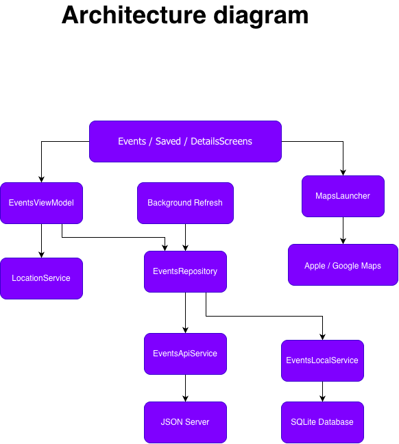
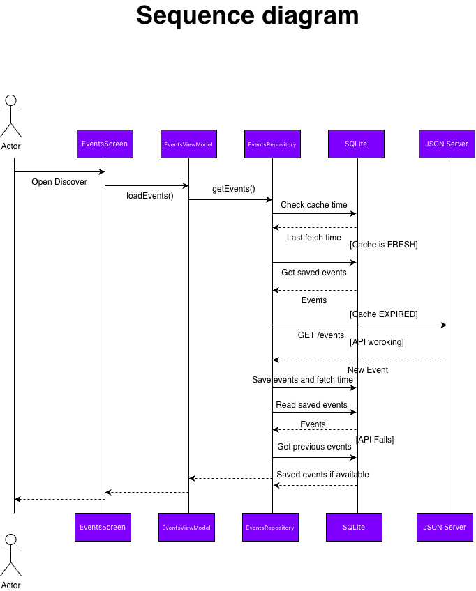

# Eventio

Eventio is a Flutter app I built for the Rogers Mobile Developer technical assessment. Users can explore nearby events, save bookmarks, view event details and get directions.

## Features

- Events loaded from a mock REST API
- SQLite for saving events and bookmarks
- 30-minute API cache with offline support
- Image caching
- Location permission and event distance
- Directions using Apple Maps or Google Maps
- Background event refresh
- Pull-to-refresh and error handling

## Tech Stack

Flutter, Dart, Provider, MVVM, SQLite (sqflite), JSON Server, http, geolocator, url_launcher, cached_network_image and workmanager.

## How to Run

**Requirements:** Flutter, Node.js and an iOS Simulator or Android Emulator. iOS 14.0 or later.

First, start the mock API:

```bash
cd mock_api
npm ci
npm start
```

Then open another terminal from the project root:

```bash
flutter pub get
```

For iOS Simulator:

```bash
flutter run --dart-define=API_BASE_URL=http://127.0.0.1:3000
```

For Android Emulator:

```bash
flutter run --dart-define=API_BASE_URL=http://10.0.2.2:3000
```

The API contains sample events and runs locally on port 3000.

## Architecture

I used MVVM with Repository Pattern. ViewModel handles screen state, while Repository handles API calls, SQLite and caching.

I kept location, background tasks and other common services separate so the code is easier to manage.





## Caching and Background Refresh

Events are saved in SQLite. If the cache is less than 30 minutes old, the app uses saved data. Otherwise, it tries the API. If API fails, it shows previously saved events.

Background refresh uses Workmanager. Android uses a six-hour interval, while iOS uses Background Fetch. Actual execution depends on the operating system.

## Testing

I added 3 unit tests for cache validity, API failure and bookmarks.

Run:

```bash
flutter test test/features/events/events_repository_test.dart
flutter analyze
```

I also tested offline storage, location, maps and background refresh manually on the iOS Simulator.

## Engineering Standards

I followed MVVM, dependency injection and reusable widgets. I kept UI and data logic separate, handled errors, used SQLite transactions and added unit tests for important logic.

## Notes

This app uses mock data, not live events. The local API must be running to download new events. Saved events and bookmarks can still be accessed offline.

### AI Usage

I used AI to generate the logo and get some UI design ideas. I also took help from AI while writing some code, fixing issues and understanding a few things. I worked on the app step by step and tested the features myself.
